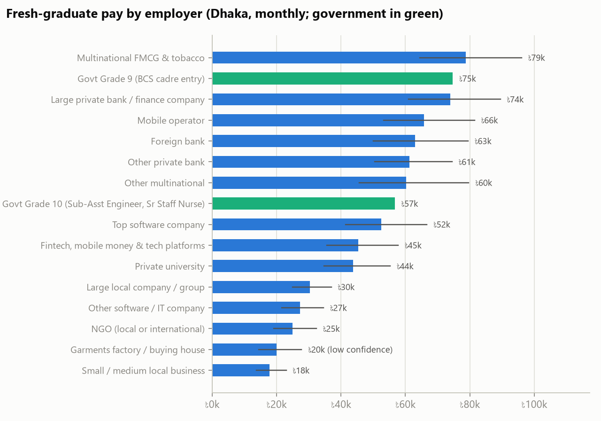
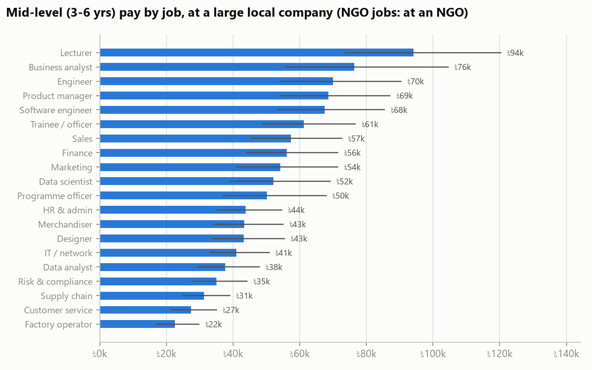
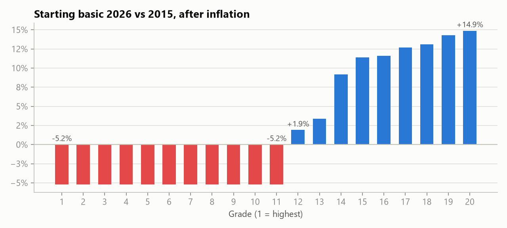
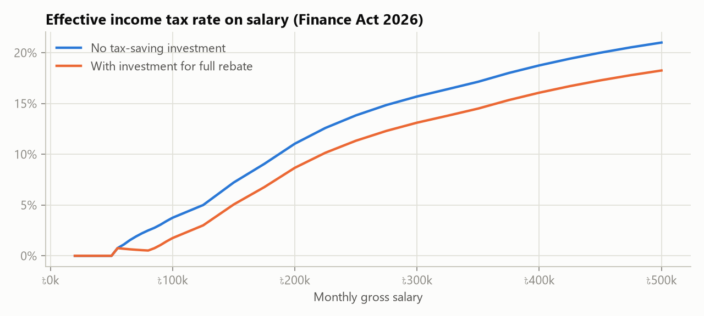

# Bangladesh Salary Market Analysis, October 2026

_Generated 2026-11-06 by `pipeline/build.py` from cited sources. All salaries are monthly gross in taka unless stated._

## Key findings

1. **Where you start matters more than what you studied.** A fresh graduate on a multinational FMCG trainee programme (Unilever, BAT and similar) earns a median of about **Tk 78,800** a month, and a trainee at a large private bank (City, MTB, DBBL, BRAC Bank) about **Tk 73,900**. A trainee or officer at a large local company (PRAN-RFL, Square, ACI) starts near **Tk 30,400**, and at a small business near **Tk 17,800**.
2. **Bank trainee pay is the best-documented number in the market.** 2025-26 circulars show MTO training pay of Tk 60,000-85,000, rising to Tk 73,000-1,00,000 on confirmation after a year.
3. **In software, the employer decides.** Entry software engineers at most local IT companies earn a median of about Tk 27,300. Top product companies (Optimizely, Cefalo, Therap, SELISE, Brain Station 23, Enosis) start near Tk 52,500, and their Levels.fyi medians range from about Tk 81,000 (Enosis) to Tk 1,67,000 (Optimizely).
4. **Government jobs now compete for graduates.** At full implementation, Grade 9 (BCS cadre entry) is worth about **Tk 74,700** a month in Dhaka, including bonuses spread over the year. That is close to large-bank trainee pay, although the basic is only Tk 30,800 until December 2026.
5. **For grades 1-11, the 2026 pay scale doesn't fully restore 2015 buying power.** Prices rose 111% between July 2015 and June 2026. Grades 1-11 got +100%, so their real starting basic is down 5.2%. Grades 12-20 got +115% to +142%, a real gain of 1.9% to 14.9%.
6. **A frozen salary has lost 30% of its buying power since July 2022.** Inflation was still 8.34% in September 2026.
7. **Salary up to Tk 50,000 a month is tax-free** (Tk 56,250 for women and people 65+). At Tk 100,000 a month the tax is Tk 45,000 a year. Investing Tk 240,000 in rebate-eligible schemes cuts it to Tk 21,000.
8. **How fast pay grows depends on the employer.** A large-bank officer goes from about Tk 73,900 as a fresher to Tk 148,200 at 6-9 years, roughly 2.0x. Published Senior Principal Officer figures (median about Tk 70,000 across banks) confirm that bank ladders are flat. A multinational FMCG fast track goes from Tk 78,800 to about Tk 235,100, roughly 3.0x. When someone moves from another kind of employer, the app counts outside years at 75% for a similar job and 40% for a different job. This is an assumption, and the app shows it.

## 1. Fresh-graduate pay by employer

| Employer group | Examples | Job | P25 | Median | P75 | Confidence |
|---|---|---|---:|---:|---:|---|
| UN agency (National Officer posts) | UNDP, UNICEF, WFP | Programme officer | 154,100 | 201,000 | 262,300 | medium |
| Multinational FMCG & tobacco | Unilever Bangladesh, BAT Bangladesh, Nestlé Bangladesh | Trainee / officer | 64,500 | 78,800 | 96,100 | high |
| Large private bank / finance company | BRAC Bank, The City Bank, Eastern Bank (EBL) | Trainee / officer | 61,000 | 73,900 | 89,500 | high |
| Mobile operator | Grameenphone, Robi Axiata, Banglalink | Trainee / officer | 53,200 | 65,800 | 81,500 | high |
| Foreign bank | Standard Chartered, HSBC, Citibank N.A. | Trainee / officer | 50,000 | 63,000 | 79,500 | medium |
| Other private bank | AB Bank, Meghna Bank, Pubali Bank | Trainee / officer | 50,500 | 61,300 | 74,500 | high |
| Other multinational | Engineering, energy & electronics multinationals, Pharma & paint multinationals, International buying offices | Trainee / officer | 45,700 | 60,300 | 79,700 | medium |
| Top software company | Optimizely, Cefalo, Field Nation | Software engineer | 41,400 | 52,500 | 66,700 | medium |
| Fintech, mobile money & tech platforms | bKash, Nagad, Pathao | Trainee / officer | 35,600 | 45,400 | 57,800 | medium |
| Private university | North South University, BRAC University, Independent University (IUB) | Lecturer | 34,800 | 43,800 | 55,300 | medium |
| Large local company / group | PRAN-RFL, Square, ACI | Trainee / officer | 25,000 | 30,400 | 37,000 | high |
| Other software / IT company | FinSource, Next Ventures, Pioneer Alpha | Software engineer | 21,600 | 27,300 | 34,600 | medium |
| NGO (local or international) | BRAC, ASA, BURO Bangladesh | Programme officer | 19,100 | 24,900 | 32,400 | medium |
| Garments factory / buying house | Export garments factories, Buying houses | Trainee / officer | 14,400 | 20,000 | 27,800 | low |
| Small / medium local business | Local SMEs, Shops, agencies and traders | Trainee / officer | 13,800 | 17,800 | 23,000 | medium |
| Government Grade 9 (BCS cadre entry) | National Pay Scale 2026 | Grade 9 | | 74,700 | | official |
| Government Grade 10 (Sub-Asst Engineer, Sr Staff Nurse) | National Pay Scale 2026 | Grade 10 | | 56,700 | | official |

UN National Officer pay (about Tk 2-3 lakh a month) comes from a single third-party transcription of the UN scale. It's shown in the app but kept out of the chart.

## 2. Pay by job function

| Job | Entry median | Mid P25 | Mid median | Mid P75 | Senior median | Best-paying employer group (mid median) |
|---|---:|---:|---:|---:|---:|---|
| University lecturer / faculty | 43,800 | 73,600 | 94,100 | 120,300 | 137,800 | Private university: 94,100 |
| Business / system analyst | 38,000 | 55,900 | 76,400 | 104,500 | 108,400 | Other software / IT company: 67,500 |
| Engineering (civil, electrical, mechanical) | 34,800 | 54,200 | 70,000 | 90,400 | 99,300 | Large local company / group: 70,000 |
| Product manager | 34,100 | 54,100 | 68,600 | 87,100 | 97,400 | Mobile operator: 151,600 |
| Software engineering | 33,500 | 53,300 | 67,500 | 85,400 | 95,700 | Top software company: 116,700 |
| Management trainee / officer | 30,400 | 48,900 | 61,200 | 76,700 | 86,900 | Multinational FMCG & tobacco: 163,300 |
| Sales & distribution | 28,500 | 45,300 | 57,300 | 72,600 | 81,300 | Large local company / group: 57,300 |
| Finance & accounts | 27,900 | 44,100 | 56,100 | 71,400 | 79,600 | Other multinational: 111,100 |
| Marketing & brand | 26,900 | 41,200 | 54,200 | 71,400 | 76,900 | Large local company / group: 54,200 |
| Data scientist / ML engineer | 25,900 | 39,200 | 52,100 | 69,100 | 73,900 | Mobile operator: 115,000 |
| Programme / field officer (development) | 24,900 | 36,900 | 50,100 | 67,900 | 71,100 | UN agency (National Officer posts): 416,300 |
| HR & admin | 21,700 | 35,100 | 43,800 | 54,600 | 62,100 | Other multinational: 86,600 |
| Merchandising (garments) | 19,600 | 34,200 | 43,400 | 55,000 | 64,500 | Garments factory / buying house: 43,400 |
| Design & creative | 21,500 | 33,700 | 43,200 | 55,400 | 61,300 | Large local company / group: 43,200 |
| IT support, network & systems | 20,400 | 33,200 | 41,000 | 50,800 | 58,200 | Mobile operator: 90,700 |
| Data & analytics | 18,700 | 29,600 | 37,600 | 47,900 | 53,400 | Large local company / group: 37,600 |
| Risk, compliance & audit | 17,400 | 27,700 | 35,000 | 44,200 | 49,600 | Other multinational: 69,200 |
| Supply chain & procurement | 15,500 | 25,100 | 31,300 | 39,000 | 44,400 | Other multinational: 61,900 |
| Customer service / call centre | 13,600 | 21,400 | 27,400 | 35,000 | 38,800 | Mobile operator: 60,500 |
| Factory worker / operator | 19,100 | 17,000 | 22,500 | 29,800 | 25,800 | Garments factory / buying house: 14,800 |

Figures are for Dhaka, at a large local company (NGO roles at an NGO). Best-paying groups count only combinations with medium or high confidence.

## 3. Government pay scale 2026

| Grade | 2015 start | 2026 start | Nominal | Real (after inflation) | Jul-Dec 2026 basic | Jan-Jun 2027 basic |
|---:|---:|---:|---:|---:|---:|---:|
| 1 | 78,000 | 156,000 | +100% | -5.2% | 109,200 | 132,600 |
| 2 | 66,000 | 132,000 | +100% | -5.2% | 92,400 | 112,200 |
| 3 | 56,500 | 113,000 | +100% | -5.2% | 79,100 | 96,050 |
| 4 | 50,000 | 100,000 | +100% | -5.2% | 70,000 | 85,000 |
| 5 | 43,000 | 86,000 | +100% | -5.2% | 60,200 | 73,100 |
| 6 | 35,500 | 71,000 | +100% | -5.2% | 49,700 | 60,350 |
| 7 | 29,000 | 58,000 | +100% | -5.2% | 40,600 | 49,300 |
| 8 | 23,000 | 46,000 | +100% | -5.2% | 32,200 | 39,100 |
| 9 | 22,000 | 44,000 | +100% | -5.2% | 30,800 | 37,400 |
| 10 | 16,000 | 32,000 | +100% | -5.2% | 24,000 | 28,000 |
| 11 | 12,500 | 25,000 | +100% | -5.2% | 18,750 | 21,875 |
| 12 | 11,300 | 24,300 | +115% | 1.9% | 17,800 | 21,050 |
| 13 | 11,000 | 24,000 | +118% | 3.4% | 17,500 | 20,750 |
| 14 | 10,200 | 23,500 | +130% | 9.2% | 16,850 | 20,175 |
| 15 | 9,700 | 22,800 | +135% | 11.4% | 16,250 | 19,525 |
| 16 | 9,300 | 21,900 | +135% | 11.6% | 15,600 | 18,750 |
| 17 | 9,000 | 21,400 | +138% | 12.7% | 15,200 | 18,300 |
| 18 | 8,800 | 21,000 | +139% | 13.1% | 14,900 | 17,950 |
| 19 | 8,500 | 20,500 | +141% | 14.3% | 14,500 | 17,500 |
| 20 | 8,250 | 20,000 | +142% | 14.9% | 14,125 | 17,062 |

Method: the real change divides the nominal ratio by cumulative CPI (2.110), which is the product of BBS 12-month average inflation for FY2015-16 to FY2025-26.

## 4. Income tax on salary (Finance Act 2026)

| Monthly gross | Annual tax | Effective rate | Marginal rate | Monthly take-home | Invest for full rebate | Tax with full rebate |
|---:|---:|---:|---:|---:|---:|---:|
| 40,000 | 0 | 0.0% | 0% | 40,000 | 0 | 0 |
| 50,000 | 0 | 0.0% | 0% | 50,000 | 0 | 0 |
| 60,000 | 8,000 | 1.1% | 10% | 59,333 | 80,000 | 5,000 |
| 80,000 | 24,000 | 2.5% | 10% | 78,000 | 192,000 | 5,000 |
| 100,000 | 45,000 | 3.8% | 15% | 96,250 | 240,000 | 21,000 |
| 150,000 | 130,000 | 7.2% | 20% | 139,167 | 390,000 | 91,000 |
| 200,000 | 265,000 | 11.0% | 25% | 177,917 | 570,000 | 208,000 |
| 300,000 | 565,000 | 15.7% | 25% | 252,917 | 930,000 | 472,000 |
| 500,000 | 1,260,000 | 21.0% | 30% | 395,000 | 1,650,000 | 1,095,000 |

Rules used: threshold Tk 4,00,000 (women/65+ Tk 4.5 lakh, disabled/third gender Tk 5.25 lakh, war-wounded freedom fighters/July warriors Tk 5.5 lakh); slabs of 10/15/20/25/30%; salary exemption of one-third of salary, capped at Tk 5 lakh; rebate equal to the lowest of 3% of taxable income, 10% of eligible investment and Tk 7.5 lakh; minimum tax Tk 5,000. Sources and confidence notes are in `pipeline/data/tax_rules.json`.

## 5. How good is the model?

- Fitted to **110 salary figures from 60 sources**: bank MTO circulars, the minimum-wage gazette, Glassdoor and Levels.fyi figures, and recruiter and salary guides. The full list is in `pipeline/data/anchors.csv`.
- **Leave-one-out test:** each figure is dropped and predicted from the rest. The median absolute error is **21.8%** (mean 25.7%) over 105 figures. A baseline that uses only the prior assumptions scores 29.2%. Those priors already encode general knowledge of the market, such as "multinationals pay more than SMEs", so the gap is modest. The data's main contribution is pinning down the actual levels.
- Median error by source type: aggregator 22.8%, blog 23.6%, job_circular 8.4%, job_post 29.7%, news 1.6%, news_secondary 51.3%, recruiter 12.2%. Job circulars are reproduced closely; single secondary sources are the noisiest.
- Each employer-job combination carries a confidence label. A combination with no direct figure (for example HR at a foreign bank) borrows the employer's general pay level, so the range shown is wider.

## 6. Limitations

- No public, crawlable dataset of Bangladeshi salaries exists, and Bdjobs.com's robots.txt disallows crawlers, so Bdjobs was not scraped. With a licensed job-post feed, `pipeline/ingest.py` can turn posts into more anchors.
- Several big employers (Unilever, BAT, Grameenphone, bKash, BRAC Bank, EBL) don't publish salaries. Their figures are crowd-reported (Glassdoor, Levels.fyi) or come from career blogs, with small samples.
- City adjustments outside Dhaka are assumptions. Pharma medical promotion officers are not covered.
- Garment worker pay uses the Tk 12,500 minimum wage of December 2023. A new minimum wage board was announced on 30 October 2026, so expect this figure to change.
- Tax rules come from post-Act guides and the Finance Bill summary. Check them against the Finance Act 2026 gazette before filing.

## Sources

- Glassdoor: Unilever Management Trainee salaries in Dhaka: <https://www.glassdoor.com/Monthly-Pay/Unilever-Management-Trainee-Dhaka-Monthly-Pay-EJI_IE3513.0,8_KO9,27_IL.28,33_IM1237.htm>
- NextJobz: Fresh graduate salary in Bangladesh 2026: <https://blog.nextjobz.com.bd/fresh-graduate-salary-in-bangladesh/>
- MTO salary in Bangladesh 2026: what circulars really pay: <https://thecvguy.net/career-tips/mto-salary-in-bangladesh/>
- Glassdoor: Grameenphone Management Trainee salaries in Dhaka: <https://www.glassdoor.com/Monthly-Pay/GrameenPhone-Management-Trainee-Dhaka-Monthly-Pay-EJI_IE405018.0,12_KO13,31_IL.32,37_IM1237.htm>
- Glassdoor: Grameenphone Customer Service Representative salaries in Dhaka: <https://www.glassdoor.com/Monthly-Pay/GrameenPhone-Customer-Service-Representative-Dhaka-Monthly-Pay-EJI_IE405018.0,12_KO13,44_IL.45,50_IM1237.htm>
- Paylab: Customer support salaries in Bangladesh: <https://paylab.com/bd/gehalter/kundendienst>
- Dutch-Bangla Bank MTO circular 2026: <https://thecvguy.net/bank-jobs/dutch-bangla-bank-plc-mto-job-circular-2026/>
- BRAC Bank MTO circular 2026 (reported): <https://www.glassdoor.com/Monthly-Pay/BRAC-Bank-Management-Trainee-Dhaka-Monthly-Pay-EJI_IE227450.0,9_KO10,28_IL.29,34_IM1237.htm>
- Bank MTO jobs in Bangladesh: every 2026 circular compared: <https://thecvguy.net/career-tips/bank-mto-jobs-bangladesh/>
- Prothom Alo: 11 organisations offer jobs without prior experience: <https://en.prothomalo.com/youth/employment/s0nj8vwh1l>
- Glassdoor: Standard Chartered Bank salaries in Bangladesh: <https://www.glassdoor.com/Salary/Standard-Chartered-Bank-Bangladesh-Salaries-EI_IE226853.0,23_IL.24,34_IN27.htm>
- Bayt.com: Standard Chartered Bangladesh salaries: <https://www.bayt.com/en/bangladesh/salaries/companies/standard-chartered-bangladesh/>
- BD Tech Jobs citing Levels.fyi: highest paying software companies 2026: <https://www.bdtechjobs.com/blog/highest-paying-software-companies-bangladesh>
- BD Tech Jobs: highest paying software companies 2026: <https://www.bdtechjobs.com/blog/highest-paying-software-companies-bangladesh>
- Glassdoor: bKash Software Engineer salaries in Dhaka: <https://www.glassdoor.com/Salary/Bkash-Software-Engineer-Dhaka-Salaries-EJI_IE555424.0,5_KO6,23_IL.24,29_IM1237.htm>
- Glassdoor: bKash Lead Engineer salaries in Dhaka: <https://www.glassdoor.com/Monthly-Pay/Bkash-Lead-Engineer-Dhaka-Monthly-Pay-EJI_IE555424.0,5_KO6,19_IL.20,25_IM1237.htm>
- Glassdoor: Software Engineer salaries in Dhaka: <https://www.glassdoor.com/Salaries/dhaka-bangladesh-software-engineer-salary-SRCH_IL.0,16_IM1237_KO17,34.htm>
- Multiplier: Average salary in Bangladesh 2026: <https://www.usemultiplier.com/bangladesh/average-salary>
- whatisthesalary.com: Software engineer salary in Bangladesh: <https://whatisthesalary.com/it-salaries/software-engineer-salary-in-bangladesh/>
- Glassdoor: Data Analyst salaries in Dhaka: <https://www.glassdoor.com/Salaries/dhaka-bangladesh-data-analyst-salary-SRCH_IL.0,16_IM1237_KO17,29.htm>
- Glassdoor: Senior Data Analyst salaries in Dhaka: <https://www.glassdoor.com/Salaries/dhaka-senior-data-analyst-salary-SRCH_IL.0,5_IC2267834_KO6,25.htm>
- Glassdoor: Graphic Designer salaries in Dhaka: <https://www.glassdoor.com/Salaries/dhaka-bangladesh-graphic-designer-salary-SRCH_IL.0,16_IM1237_KO17,33.htm>
- ManpowerBD: Bangladesh salary benchmarks 2026: <https://manpower.com.bd/insights/bangladesh-salary-benchmarks>
- Glassdoor: HR Executive salaries in Dhaka: <https://www.glassdoor.com/Salaries/dhaka-bangladesh-hr-executive-salary-SRCH_IL.0,16_IM1237_KO17,29.htm>
- Glassdoor: Civil Engineer salaries in Dhaka: <https://www.glassdoor.com/Salaries/dhaka-bangladesh-civil-engineer-salary-SRCH_IL.0,16_IM1237_KO17,31.htm>
- PCTechMag citing The Business Standard: career paths in apparel: <https://pctechmag.com/2026/08/career-paths-for-professionals-in-manufacturing-and-apparel-industries/>
- Buying-house job posting in Gulshan-1 (seen in web search Oct 2026; original URL not captured)
- Minimum Wage Board gazette for RMG workers (Dec 2023; still in force Nov 2026): <https://en.ittefaq.com.bd/6792/tk-12-500-finalised-as-minimum-rmg-wage>
- UNjobnet: UN NO-A salary in Dhaka (scale effective Oct 2024): <https://www.unjobnet.org/countries/bangladesh/Dhaka/salary/no-a>
- Glassdoor: PRAN-RFL Center Management Trainee salaries: <https://www.glassdoor.com/Monthly-Pay/PRAN-RFL-Center-Management-Trainee-Bangladesh-Monthly-Pay-EJI_IE530328.0,15_KO16,34_IL.35,45_IN27.htm>
- Glassdoor: Senior Principal Officer salaries in Dhaka: <https://www.glassdoor.com/Salaries/dhaka-bangladesh-senior-principal-officer-salary-SRCH_IL.0,16_IM1237_KO17,41.htm>
- Glassdoor: Pubali Bank Senior Principal Officer salaries: <https://www.glassdoor.com/Salary/Pubali-Bank-Senior-Principal-Officer-Bangladesh-EJI_IE545108.0,11_KO12,36_IL.37,47_IN27.htm?filter.payPeriod=MONTHLY>
- Glassdoor: Dutch-Bangla Bank Relationship Manager salaries: <https://www.glassdoor.com/Salary/Dutch-Bangla-Bank-Relationship-Manager-Bangladesh-Salaries-EJI_IE547664.0,17_KO18,38_IL.39,49_IN27.htm>
- Bayt.com: Dutch-Bangla Bank salaries: <https://www.bayt.com/en/bangladesh/salaries/companies/dutch-bangla-bank-ltd/>
- Bayt.com: BRAC Bank salaries: <https://www.bayt.com/en/bangladesh/salaries/companies/brac-bank/>
- Glassdoor: Data Scientist salaries in Dhaka: <https://www.glassdoor.com/Salaries/dhaka-bangladesh-data-scientist-salary-SRCH_IL.0,16_IM1237_KO17,31.htm>
- Glassdoor: Machine Learning Engineer salaries in Dhaka: <https://www.glassdoor.com/Salaries/dhaka-bangladesh-machine-learning-engineer-salary-SRCH_IL.0,16_IM1237_KO17,42.htm>
- Glassdoor: Senior Machine Learning Engineer salaries in Dhaka: <https://www.glassdoor.com/Salaries/dhaka-bangladesh-senior-machine-learning-engineer-salary-SRCH_IL.0,16_IM1237_KO17,49.htm>
- Glassdoor: AI Engineer salaries in Dhaka: <https://www.glassdoor.com/Salaries/dhaka-bangladesh-artificial-intelligence-engineer-salary-SRCH_IL.0,16_IM1237_KO17,49.htm>
- Glassdoor: Data Scientist salaries in Dhaka (Grameenphone): <https://www.glassdoor.com/Salaries/dhaka-bangladesh-data-scientist-salary-SRCH_IL.0,16_IM1237_KO17,31.htm>
- Glassdoor: Data Scientist salaries in Dhaka (SSL Wireless): <https://www.glassdoor.com/Salaries/dhaka-bangladesh-data-scientist-salary-SRCH_IL.0,16_IM1237_KO17,31.htm>
- Glassdoor: Product Manager salaries in Dhaka: <https://www.glassdoor.com/Salaries/dhaka-bangladesh-product-manager-salary-SRCH_IL.0,16_IM1237_KO17,32.htm>
- Glassdoor: Senior Product Manager salaries in Dhaka: <https://www.glassdoor.com/Salaries/dhaka-bangladesh-senior-product-manager-salary-SRCH_IL.0,16_IM1237_KO17,39.htm>
- Glassdoor: Junior Product Manager salaries in Dhaka: <https://www.glassdoor.com/Salaries/dhaka-junior-product-manager-salary-SRCH_IL.0,5_IM1237_KO6,28.htm>
- Glassdoor: Associate Product Manager salaries in Dhaka: <https://www.glassdoor.com/Salaries/dhaka-associate-product-manager-salary-SRCH_IL.0,5_IM1237_KO6,31.htm>
- Glassdoor: Grameenphone Product Manager salaries: <https://www.glassdoor.com/Monthly-Pay/GrameenPhone-Product-Manager-Dhaka-Monthly-Pay-EJI_IE405018.0,12_KO13,28_IL.29,34_IS3812.htm>
- Glassdoor: Product Manager salaries in Dhaka (bKash, Pathao): <https://www.glassdoor.com/Salaries/dhaka-bangladesh-product-manager-salary-SRCH_IL.0,16_IM1237_KO17,32.htm>
- Glassdoor: Supply Chain Executive salaries in Dhaka: <https://www.glassdoor.com/Salaries/dhaka-supply-chain-executive-salary-SRCH_IL.0,5_IS3812_KO6,28.htm>
- Glassdoor: Procurement Executive salaries in Dhaka: <https://www.glassdoor.com/Salaries/dhaka-procurement-executive-salary-SRCH_IL.0,5_IC2267834_KO6,27.htm>
- Transcom Foods: Executive - Procurement job post: <https://bdjobs.com/h/details/1517219?ln=1>
- Glassdoor: Network Engineer salaries in Dhaka: <https://www.glassdoor.com/Salaries/dhaka-bangladesh-network-engineer-salary-SRCH_IL.0,16_IM1237_KO17,33.htm>
- Glassdoor: Support Engineer salaries in Dhaka: <https://www.glassdoor.com/Salaries/dhaka-bangladesh-support-engineer-salary-SRCH_IL.0,16_IM1237_KO17,33.htm>
- Glassdoor: IT Systems Administrator salaries in Dhaka: <https://www.glassdoor.com/Salaries/dhaka-bangladesh-it-systems-administrator-salary-SRCH_IL.0,16_IM1237_KO17,41.htm>
- Glassdoor: IT Systems Administrator salaries in Dhaka (The City Bank): <https://www.glassdoor.com/Salaries/dhaka-bangladesh-it-systems-administrator-salary-SRCH_IL.0,16_IM1237_KO17,41.htm>
- Glassdoor: Compliance Officer salaries in Dhaka: <https://www.glassdoor.com/Salaries/dhaka-bangladesh-compliance-officer-salary-SRCH_IL.0,16_IM1237_KO17,35.htm>
- Glassdoor: Senior Compliance Officer salaries in Dhaka: <https://www.glassdoor.com/Salaries/dhaka-senior-compliance-officer-salary-SRCH_IL.0,5_IC2267834_KO6,31.htm>
- Glassdoor: Audit Officer salaries in Dhaka: <https://www.glassdoor.com/Salaries/dhaka-bangladesh-audit-officer-salary-SRCH_IL.0,16_IM1237_KO17,30.htm>
- Glassdoor: Internal Audit Officer salaries in Dhaka: <https://www.glassdoor.com/Salaries/dhaka-bangladesh-internal-audit-officer-salary-SRCH_IL.0,16_IM1237_KO17,39.htm>
- Glassdoor: BRAC University Lecturer salaries in Dhaka: <https://www.glassdoor.com/Monthly-Pay/Brac-University-Lecturer-Dhaka-Monthly-Pay-EJI_IE537788.0,15_KO16,24_IL.25,30_IM1237.htm>
- Private University Faculty Salary Explorer (crowd-sourced): <https://mhalder-dev.github.io/salary-explorer/>
- The Business Standard: Gazette issued for National Pay Scale 2026: <https://www.tbsnews.net/bangladesh/gazette-issued-national-pay-scale-2026-1547116>
- The Daily Star: Govt approves National Pay Scale 2026: <https://www.thedailystar.net/news/governance/news/govt-approves-national-pay-scale-2026-4261321>
- Grade table cross-checked: bdjobs52.com pay scale calculator; eTothyo (31 Aug 2026): <https://etothyo.com/new-pay-scale-salary-structure/>
- The Financial Express: Average annual inflation cools to 8.68% in FY26: <https://thefinancialexpress.com.bd/economy/average-annual-inflation-cools-to-868-per-cent-in-fy26>
- UNB: Food inflation rises, pushes up overall inflation in September: <https://unb.com.bd/category/Business/food-inflation-rises-pushes-up-overall-inflation-in-september/197246>
- The Daily Star: Finance bill passed, tax-free income threshold set at Tk 4 lakh for FY2026-27: <https://www.thedailystar.net/business/bangladesh-budget-2025-26/news/finance-bill-passed-tax-free-income-threshold-set-tk-4-lakh-fy2026-27-4211511>
- Roy Law Nexus: Bangladesh Income Tax Guide 2026-27: <https://roylawnexus.com/legal-insights/bangladesh-income-tax-2026-finance-act-amendments>
- KPMG Bangladesh (Rahman Rahman Huq): Salient features of Finance Bill 2026: <https://assets.kpmg.com/content/dam/kpmg/bd/pdf/Salient_features_of_Finance_Bill_2026(Tax-and_VAT).pdf>
- Arthonitee: Bangladesh tax changes for 2026-27: <https://www.arthonitee.com/guides/bangladesh-tax-changes-2026-27>

---

_BD Salary Compass. Designed and developed by Atiqul Islam Chowdhury._
